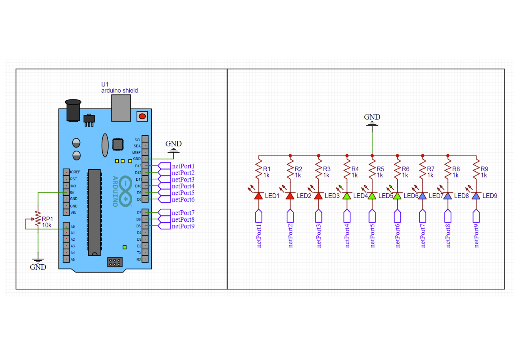
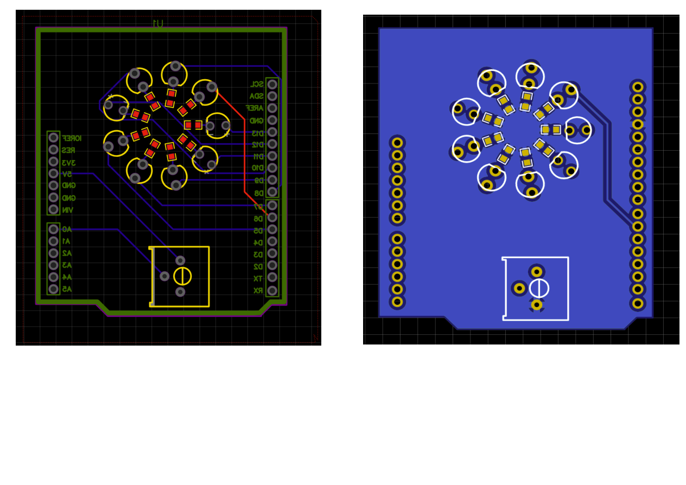
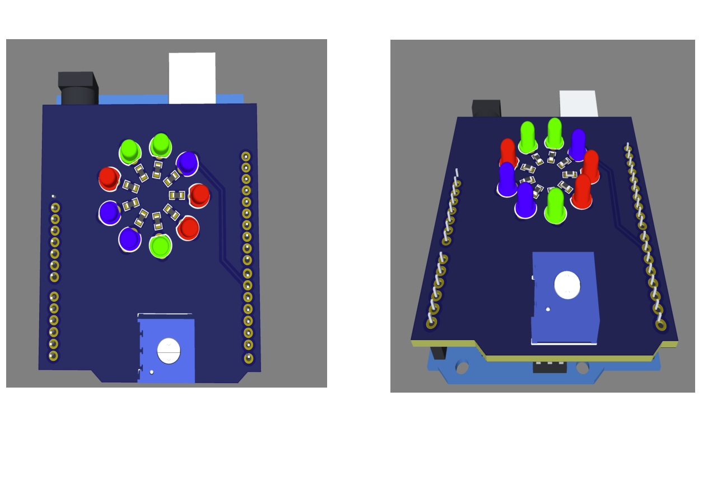

# Arduino LED Shield PCB

**9 LEDs · 9 × 1 kΩ resistors · 10 kΩ potentiometer · Arduino Uno shield**

A custom Arduino LED shield designed in EasyEDA as a PCB course project by **Zarraf Alam Fahmid**. The design brings nine LED outputs and an analog potentiometer input onto a shield-format circuit board.

[View the project PDF](Arduino_LED_Shield_PCB_Report.pdf)

## Design overview

- Nine LED channels connect to Arduino digital pins **D5–D13** through named schematic nets.
- Each LED channel includes a **1 kΩ** series resistor.
- A **10 kΩ potentiometer** provides an adjustable signal to **A0**, with its outer terminals connected to 5 V and GND.
- The PCB places the LEDs in a circular arrangement and uses headers aligned with the Arduino shield footprint.

## Components

| Component | Quantity / value |
|---|---|
| Arduino Uno shield interface | 1 |
| LEDs | 9 |
| Current-limiting resistors | 9 × 1 kΩ |
| Potentiometer | 1 × 10 kΩ |
| Shield headers | As shown in the layout |

## Schematic

## PCB layout

## 3D assembly preview

## Design work

The project covers schematic capture, net labeling, component footprints, placement, PCB routing, and 3D assembly review. The PDF contains the original schematic, layout, and board renders.

## Repository contents

- `Arduino_LED_Shield_PCB_Report.pdf` — original three-page design document.
- `images/` — readable previews rendered from that document.

This repository documents the PCB design. Native EasyEDA files, manufacturing outputs, firmware, and measured hardware test results are not included.
